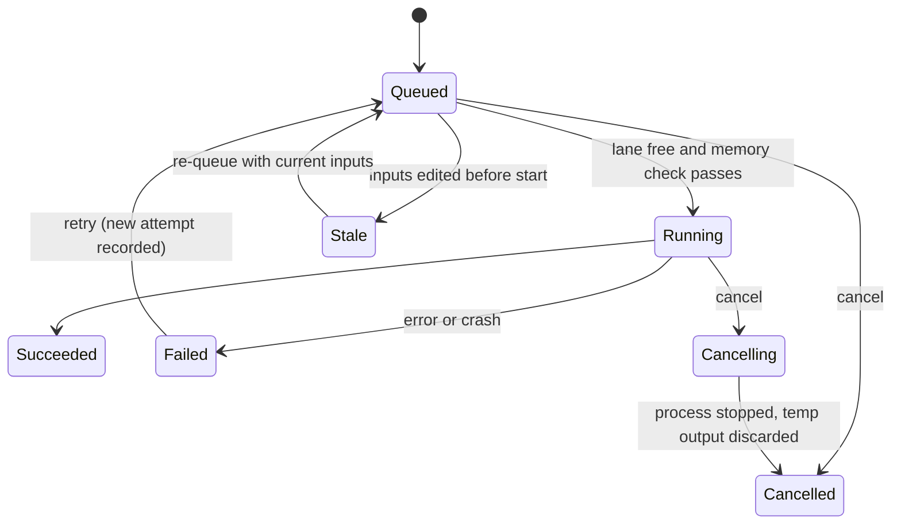

# 02 · Product specification

A local, single-user app that takes an episode from idea to exported video. Runs on the author's Mac, uses no paid services and does not automate any website.

## 1. Episode journey

Nine stages. The stepper shows state (done, current, stale, blocked) and never gates navigation.

| # | Stage | Input | Output (artifact) | Done when |
|---|---|---|---|---|
| 1 | Idea | Topic, learning objective, audience | Brief | Brief marked locked |
| 2 | Research | Sources; imported ChatGPT research packets | Source notes with provenance | Each used claim has an approved source |
| 3 | Script | Brief, research, imported or typed script | Segments, each with caption text and spoken text | Segments validated; every segment has an id |
| 4 | Storyboard | Segments | Scene list, scene type and layout per scene | Every segment belongs to a scene |
| 5 | Voice | Spoken text, voice profile | Blocks with takes and word/segment timing | No stale blocks; one take chosen per block |
| 6 | Scenes | Scene params, layout, beats | Scene definitions, beats anchored to words | Fit check passes for every scene |
| 7 | Review | A rendered MP4 | Timestamped notes, automated checks | No open notes, checks pass |
| 8 | Render | Everything above | Preview and final MP4 | Final render's inputs equal the current revision |
| 9 | Export | Final render | Package (see 2.9) | Checksums written |

### 2.1 Idea
Backlog of topics. Each has an objective, audience, hook and a verdict (go, park, drop). "New episode" starts here.

### 2.2 Research
Sources are records, not free text: title, link or file, date, notes, and which segments rely on them. Items from ChatGPT arrive as **Proposed** and become part of the episode only when approved, section by section.

### 2.3 Script
Segment = caption text (what is shown) plus spoken text (what is read). The two can differ, for example `₹600` shown and "six hundred rupees" spoken. Editing either marks dependent artifacts stale (section 4).

### 2.4 Storyboard
Assign each segment to a scene, choose a scene type and a layout. The app proposes a layout from content density; the author decides.

### 2.5 Voice
* Voice profile "Pip voice v1": Qwen3-TTS Base 1.7B, approved reference B-US, read-only.
* Unit of generation is a **block**: one or more consecutive segments (default up to 20 s or 60 words; merge/split allowed).
* Each block keeps a list of **takes**. Re-roll creates a new take with a new seed; the author picks one.
* Pronunciation overrides live in the spoken text.
* Pacing between blocks is an explicit control, default natural.
* Only stale blocks regenerate; neighbours are never touched.
* Before running, the app shows estimated time and peak memory.

### 2.6 Scenes (the editor)
Outline, live preview, inspector, timeline. See [03](03-navigation-and-editor-mockup.md). Controls are tiered (section 6).

### 2.7 Review
Reviews are of a **rendered MP4**, not the live preview. See section 7.

### 2.8 Render
Preview renders can be a frame range or a single scene. Final render is always a full render. Progress, cancel and retry are common to all jobs (section 5).

### 2.9 Export
Final MP4, loudness-mastered audio, SRT and VTT captions, thumbnails, a source package (episode JSON, voice takes, scene params), and a checksums file.

## 2. Autosave, revisions, recovery

| Requirement | Behaviour |
|---|---|
| Autosave | Every edit is appended to a journal and fsync'd before the UI shows "saved". The visible state is always one of saved, saving, or error with a retry. |
| Atomic writes | `episode.json` is written to a temp file and renamed. A crash never leaves a half-written file. |
| Revisions | Numbered revisions (r14). Automatic checkpoints every N operations or 5 minutes, before bulk or destructive actions, on approve and on final render. Manual milestones with a name. |
| Compare / restore | Diff between any two revisions. Restore creates a **new** revision; nothing is overwritten. |
| Recovery after restart | On launch the app replays the journal, restores the last open episode and view, and reconciles jobs: anything that was running becomes *Failed (interrupted)* with a Retry button. |
| Single writer | A PID lockfile prevents two app instances editing one project. |

## 3. Selective narration regeneration and caching

* Cache key: hash of (spoken text, voice profile and reference hash, model snapshot, sampling and seed policy, engine version).
* Same key means reuse the stored take. Anything different means a new take.
* Editing one sentence regenerates only its block. The rest are reused.
* Generation is sequential on the heavy lane, and memory is checked first (section 5).
* Known trade-off: block boundaries can show slight prosody or voice drift between blocks. Mitigation: blocks are at most about 20 s, and the pacing control makes gaps explicit. Whether drift is audible must be judged by listening on a real episode, not assumed.

## 4. Invalidation

Every artifact records the hash of its inputs. Status is computed, not stored: an artifact is **fresh** only if its recorded input hash equals the current one.

| Edit | Becomes stale |
|---|---|
| Spoken text of a segment | That segment's block audio, then timing from that point on, then beats anchored in that segment (warn if an anchor word changed), then renders |
| Caption text only | Captions and renders (audio is unaffected) |
| Scene params, layout, theme, scene code | Renders only |
| Voice profile or reference | All block audio, then everything downstream |
| Review note edits | Nothing |

Stale artifacts are kept until replaced. Badges show what is stale and the cost to refresh it. A final export always does a full render.

## 5. Jobs

| Kind | Lane |
|---|---|
| validate, timing.build, verify, export (non-render parts) | Light (parallel) |
| tts.block, render.preview, render.final | Heavy (one at a time; TTS and render never overlap) |

Lifecycle (text form; a graphical version was dropped because the diagram tool could not lay it out without crossings):

* Progress: typed events (percent, step, message), pushed to the UI. A disconnected UI resumes from the last event id.
* Cancel: TTS worker gets SIGTERM, then SIGKILL after a grace period; renders use Remotion's cancel signal. The job's temp folder is deleted, so no partial files reach the project.
* Retry: manual, one click, attempts are listed. One automatic retry only for a known transient worker crash.
* Memory: before a heavy job, check macOS memory pressure and swap. During a job, log peak and pressure. Kill rule carried over from the Qwen runs: critical pressure for 5 consecutive 2-second samples.

## 6. Scene controls: reusable versus custom

| Tier | What | Who edits | Examples |
|---|---|---|---|
| 1 | Data-driven scene types with a param schema, a cue vocabulary, layout needs and a minimum text size | Author, in the app | claim card, compare lanes, steps list, SQL run, table lab, cards, callout/zoom, KPI mismatch, big statement |
| 2 | Beats and mascot behaviours anchored to words | Author, in the app | look at, point at, expression, reaction, zoom, highlight, reveal |
| 3 | Custom scene as code (`SceneDefinition`: id, params schema, cues, layout needs, component) | Developer | The Pip 10x scene |

Rules: custom work is never hidden inside Tier 1 types. A Tier 3 scene used by two or more episodes is a candidate for promotion to Tier 1. **Acceptance test for the whole design:** recreate `pip-scene-10x` from data plus a registered Tier 3 component and match the preserved MP4.

## 7. Review notes

* A note has: timestamp, anchor (segment id, word offset), type (voice, visual, copy, timing, factual), status (open, resolved, won't fix), the render it was written against, and an optional frame region.
* `N` adds a note at the playhead anywhere there is one.
* Notes belong to a **review round**, which belongs to a render.
* When a segment is edited, notes anchored to it re-anchor to the new time, or are flagged "anchor edited" if the word is gone.
* Automated checks run alongside: resolution and codec, audio present, length versus narration, speech onset drift versus timeline, on-screen numbers versus data, caption overlap, minimum text size, render inputs versus current revision.
* Export notes as Markdown or CSV.

## 8. Importing ChatGPT output (no API, no automation)

1. The app provides copy-ready prompt templates for research and for script.
2. The author uses ChatGPT in their own browser and pastes the result back, or opens a saved file.
3. Accepted shapes: JSON, Markdown with a fenced JSON block, or a plain script.
4. JSON is validated strictly, with exact error locations. A plain script is split heuristically into segments and the author confirms the split.
5. A diff preview shows what will be added. Items arrive as Proposed, with provenance (source, date, content hash), and need approval per section.

## 9. Layouts and the mascot

* Layouts are data templates: stage + fixed mascot, split-dense (mascot docked at a side or corner, about 0.55 scale, peeks on reactions), full stage + peek, mascot focus, two-up and stacked.
* The mascot is a layout slot with modes docked, floating, peek, hidden. It is not a fixed region.
* A fit check computes the smallest text size for the chosen layout against a minimum (36 px in the mockup) and flags violations before render. Safe zones: top about 96 px, bottom about 380 px, with a configurable caption zone.
* Layout changes animate at beat boundaries, never mid-sentence.

## 10. Non-goals

No paid APIs, no website automation, no cloud, no multi-user, no wholesale rewrite, no new mascot or voice auditions, no full episode in the prototype style until the app exists.
