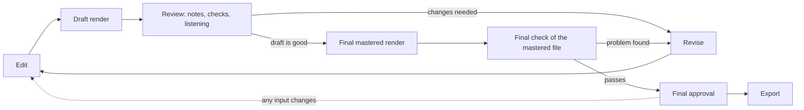
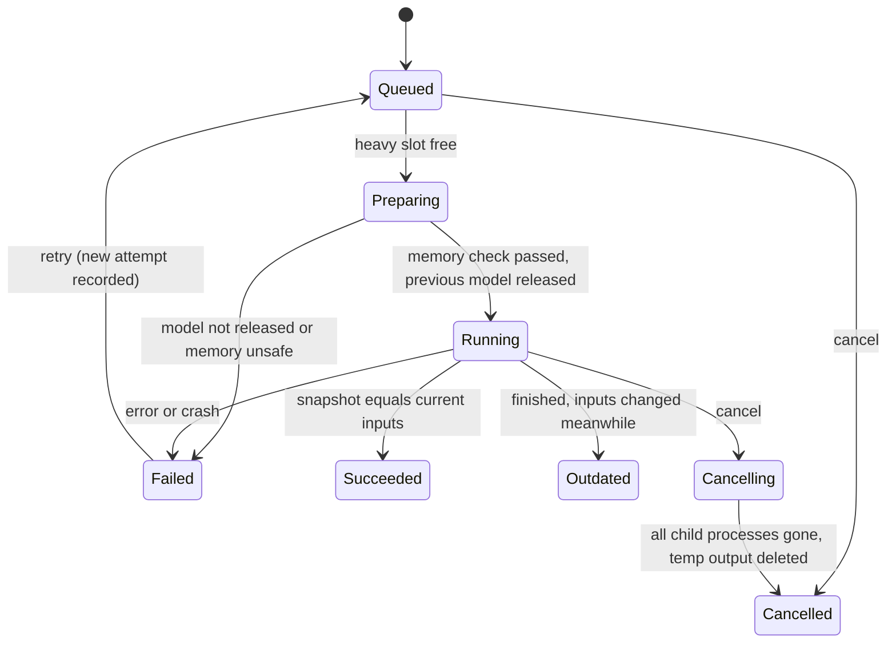

# 02 · Product specification

A local browser app that takes an episode from idea to exported video. It runs on the author's Mac, uses existing subscriptions and free tools only, and does not call paid APIs or automate any website. Revised after review; the changes are summarised in [README](README.md#changes-in-this-revision).

## 1. Episode journey

Nine stages. The stepper shows state (done, current, stale, blocked) and never gates navigation. Stages 7 to 9 follow the review loop in section 2.

| # | Stage | Input | Output | Done when |
|---|---|---|---|---|
| 1 | Idea | Topic, objective, audience | Brief | Brief locked |
| 2 | Research | Sources; imported ChatGPT packets | Source notes with provenance | Each claim used has an approved source |
| 3 | Script | Brief, research, imported or typed script | Segments (caption text, spoken text) | Segments validate |
| 4 | Storyboard | Segments | Scene list, scene type and layout per scene | Every segment is in a scene |
| 5 | Voice | Spoken text, voice profile | Blocks with takes and timing | No stale or missing blocks; one take chosen per block |
| 6 | Scenes | Scene params, layout, beats | Scene definitions, beats anchored to words | Fit check passes for every scene |
| 7 | Review | A rendered MP4 (draft, then final) | Timestamped notes, check results, sign-offs | No open notes; checks pass; manual items ticked |
| 8 | Render | The above | Draft and final MP4 | Final render's inputs equal the current inputs |
| 9 | Export | The approved final file | Package | Package checksums verify |

Stage notes:

* **Idea.** A backlog of topics with objective, audience, hook and a verdict (go, park, drop).
* **Research.** Sources are records (title, link or file, date, notes, which segments rely on them). ChatGPT items arrive as Proposed and join the episode only when approved (section 9).
* **Script.** A segment has caption text (shown) and spoken text (read). They may differ where intended, for example `₹600` shown and "six hundred rupees" spoken (section 7.2).
* **Storyboard.** Assign segments to scenes, scene types and layouts. The app proposes a layout from content density; the author decides.
* **Voice.** See sections 5 and 6.
* **Scenes.** Controls are tiered (section 11).

## 2. The review loop

Definitions:

| Term | Meaning |
|---|---|
| Draft render | Full or ranged render for review. Audio is the unmastered mix. Never approvable. |
| Final render | Full render whose audio has the final mastering chain applied. The **file that is reviewed in the final check is the file that is exported.** |
| Mastering | The final audio chain on the whole mix (voice, sound accents, music): integrated loudness and true-peak limiting. Defaults match the existing narration finish step (target −16 LUFS integrated, −1.5 dBTP) and are settings, not hard-coded. |
| Approval | A record: final render id, that file's SHA-256, and the hash of every input that produced it. |
| Export | Copies the approved file into a package and verifies its SHA-256 against the approval. |

Rules:

1. Export **never renders or masters**. If the approved file is missing or its hash differs from the approval, export stops with an error.
2. Approval is **computed, not remembered**. Whenever the current input hash differs from the approved input hash, the approval shows as void, with the list of changed components. Re-approval needs a new final render.
3. Only inputs that affect the final file are hashed (section 4). Changing a review note or an internal label does not void approval; changing a caption, a font file or the sound mix does.
4. Review notes belong to a round, a round belongs to one render, and a note records whether it was written against a draft or the final file.
5. Derived files in the package (SRT/VTT, thumbnails) are produced from the approved snapshot and the approved file by reading it, never by re-encoding it.
6. The final check runs on the mastered file itself (section 7.4), so mastering is part of what was reviewed.

## 3. State, autosave, revisions, recovery

One authority: the **project database** (SQLite, write-ahead log). Large files live in a content-addressed blob folder and are referenced from it. Details and the recovery protocol are in [04](04-architecture.md#project-state-store-and-recovery).

| Requirement | Behaviour |
|---|---|
| Autosave | Each edit is one database transaction. "Saved" is shown only after the commit returns. States: saved, saving, error (with retry). |
| Revisions | Immutable numbered snapshots (r14). Automatic checkpoints on a schedule, before bulk or destructive actions, on approval and on final render; manual named milestones. |
| Compare and restore | Diff any two revisions. Restore creates a new revision; nothing is overwritten. |
| Recovery | Reopening after a crash or kill resumes at the last committed edit. Jobs that were running become Failed (interrupted) with Retry. |
| Git | `episodes/<id>/episode.json` is a one-way projection of the current revision, rewritten after commits, for readable diffs. If the file is changed outside the app (hand edit, legacy CLI), the app detects it by hash and offers to import it as a new revision. It is never overwritten silently. |
| Single writer | A lock prevents two app instances using one project. |
| Legacy commands | `./studio` reads only what the v1 format can express. A document that uses a v2-only feature is written to `episode.json` as v2, and the legacy commands refuse it with the reason. **They never substitute a Kokoro voice for a Qwen episode**, with or without acknowledgement. A lossy v2-to-v1 *export* (for inspection) needs an explicit `--accept-loss` and carries a visible note. |

## 4. Dependencies, invalidation and immutable snapshots

### 4.1 Dependency hashes

An artifact is **fresh** only if the hash of its inputs equals the hash it was built from. Status is computed.

| Artifact | Its hash includes |
|---|---|
| Narration take (per block) | Spoken text of the block's segments, pronunciation overrides, voice profile id, reference audio hash, engine and model snapshot id, engine version, sampling settings and seed |
| Timing | Hashes of all selected takes, pacing and block gaps, aligner model id and version, spoken and caption text, manual timing corrections, hash of the timeline logic and cue rules |
| Sound mix | The selected takes (their expected hashes and blob hashes, so the audio itself), pacing and block gaps, sound-event list, hashes of every sound asset, mix parameters; for the final mix, also the mastering parameters. It does **not** include timing or caption text, so a caption-only edit does not force a remix |
| Render | Render-relevant episode content (scene params, layouts, beats, caption text), theme tokens, timing hash, sound-mix hash, **assets** (image and icon file hashes), **fonts** (font file hashes and family mapping), **scene code** (hash of every source file the video bundle imports, including shared components and animation helpers), Remotion and browser versions, **render settings** (size, fps, codec, quality, audio codec and bitrate, frame range, mastered or not) |
| Check results | Render file hash and check-suite version |
| Approval | Final render file hash and its render hash |
| Export package | Approval and export preset |

| Edit | Becomes stale |
|---|---|
| Spoken text | That block's take, then timing, then beats anchored in its segments (warn if an anchor word changed), then sound mix, then renders and approval |
| Caption text only | Timing of captions, renders, approval (audio unaffected) |
| Scene params, layout, theme, font, asset, scene code | Renders and approval only |
| Sound events or mix | Sound mix, renders, approval |
| Voice profile or reference | All takes, then everything downstream |
| Selecting a different take for a block | Timing, both mixes, renders and approval (the audio changed); the takes themselves stay fresh |
| Mastering targets (configurable; defaults −16 LUFS, −1.5 dBTP) | The final mix, the final render and approval; draft outputs stay fresh |
| Review notes | Nothing |

Stale artifacts are kept until replaced. Badges show what is stale and what refreshing costs.

### 4.2 Immutable input snapshots

1. When a job is enqueued the app builds an **input snapshot**: the revision plus the hash of every component in 4.1. The snapshot is stored and the job is bound to it.
2. The job reads only from the snapshot: the episode content is a frozen copy, artifacts are fetched by hash, and source code, theme and fonts are copied into the job's workspace (the video source is a few megabytes), so the bundle is built from the copy. Later edits cannot reach a running job.
3. Outputs are stored under the snapshot's hash.
4. On completion the app compares the snapshot hash with the current input hash inside one transaction:
   * equal: the output becomes the current artifact for that kind;
   * different: the job is recorded as **Succeeded, outdated**. The output is kept and labelled "made for r14; current is r15". It never becomes the current artifact and is never used for export.
5. The **approved file pointer moves only on an explicit approval action**. No job completion, retry or cleanup can change it.
6. While a job runs on an old snapshot, the UI says so ("running on r14; r15 has changes") and offers cancel.

## 5. Selective narration regeneration and caching

* Generation unit is a **block**: one or more consecutive segments (default up to 20 s or 60 words). The author can split and merge blocks. A segment is never cut in the middle.
* Each block keeps a list of **takes**. Re-roll creates a take with a new seed. The author picks one take per block; the choice is stored in the project.
* A take is reused when its hash (4.1) matches. Editing one sentence regenerates only its block.
* Pacing between blocks is an explicit control; default is the model's natural pause.
* Before a run the app shows estimated time and peak memory. The estimate comes from earlier measured runs on this machine.
* Trade-off: blocks can differ slightly in prosody. Block size is capped and whether the seams are audible is a listening judgement at review.

## 6. Timing and alignment

Every word carries a **timing source**, shown in the UI and kept in the timeline:

| Source | Meaning |
|---|---|
| `aligned` | Produced by a local forced-alignment model against the actual audio |
| `estimated` | Derived from the audio's loudness envelope and word-length weights. A labelled fallback, available when alignment is unavailable, fails its checks, or has not been installed |
| `manual` | Corrected by the author; kept across re-alignment as long as the take is unchanged |

Plan:

* Use a local forced aligner (candidate: Qwen3-ForcedAligner-0.6B on Apple Silicon via the already-installed `mlx-audio`; evaluation in [04](04-architecture.md#alignment-option-evaluation)). Nothing is downloaded until the author approves.
* Alignment runs on the spoken text. Mapping from spoken words to displayed words (for example "six hundred rupees" to `₹600`) uses the existing mapping logic in `pipeline/timeline.py`.
* After alignment, plausibility checks run on measured values: monotonic times, no word shorter than a minimum, first and last word close to the audio's speech onset and offset, no word covering a long silence. A failing block falls back to `estimated`, with a warning.
* The author can correct a word boundary on a waveform. The correction is stored as `manual`.
* **No claim of perfect timing.** Alignment is an estimate that is usually closer than the envelope fallback. Its error on this voice will be measured against hand-marked word boundaries on sample blocks before the app states any accuracy (Phase 2).

## 7. Quality checks

Every check is labelled **measured** (the app computes a result from the file or data), **manual** (a person must look or listen; the app records that it happened), or **limited** (works only for part of the content).

### 7.1 Narration complete and not truncated

| Check | Kind |
|---|---|
| Every segment belongs to a block with a selected, fresh take whose audio file exists | measured |
| Block duration is within a plausible range for its word count | measured |
| Audio has speech energy across the block and no silent gap longer than a set limit | measured |
| Audio does not end abruptly (no clipped final samples; trailing silence present) | measured |
| Alignment plausibility (section 6) | measured |
| Every word was actually spoken | **manual**: alignment assigns times to the text it is given, so a dropped word cannot be proven absent by it. Listening is required. |

### 7.2 Captions versus spoken text

| Check | Kind |
|---|---|
| Caption phrases spell exactly the segment text (already in the schema) | measured |
| A spoken override exists wherever the caption contains symbols or numbers that need one | measured |
| Spoken numbers match the caption (for example 600 against "six hundred", using the same number-to-words logic as `verify`) | measured |
| Words in the caption that are not in the spoken text, and the reverse, are listed as a diff | measured; the author confirms each intentional difference |

### 7.3 Fonts, overflow, obscured content

Run against sampled frames (each beat, plus a regular interval) in the same browser engine that renders the video.

| Check | Kind |
|---|---|
| Each declared font family and weight is loaded before the first frame; a fallback font is a failure | measured |
| Text boxes marked essential do not overflow their container | measured, for DOM text |
| Essential boxes do not overlap each other, the caption zone, the mascot box or the unsafe areas | measured, for elements marked essential |
| Smallest rendered text size against the layout's minimum | measured, for DOM text |
| Anything drawn in SVG, canvas or images (custom scenes) | **limited**: only generic checks apply; correctness is manual (7.5) |

### 7.4 Mastering is in the reviewed file

| Check | Kind |
|---|---|
| The audio decoded from the final MP4 meets the loudness and true-peak targets | measured on the file |
| The review session is bound to the file's SHA-256, and that hash is the one approval records | measured |
| A draft file always reports "not mastered" and cannot enter approval | measured |

### 7.5 Manual review, alongside the automated checks

Approval needs these recorded confirmations on the final file; the app cannot verify them.

* Listened to the whole file (voice, pauses, accents, sound accents).
* Watched at phone size with sound on.
* Looked at the frames of every custom (Tier 3) scene.
* Resolved or dismissed all open notes.

The app records what it can observe: which time ranges of the final file were played, and when each box was ticked. This shows the file was played, not that attention was paid, and the UI says so. **The app does not claim that arbitrary custom scenes can be verified automatically.** A scene may supply optional checks of its own; without them, only the generic checks and the manual items apply.

## 8. Jobs

| Kind | Lane |
|---|---|
| validate, timeline build, alignment plausibility, verify, check suites | Light (parallel) |
| tts.block, align, mix and master, render.draft, render.final | Heavy (one at a time) |

### 8.1 Lifecycle

### 8.2 Rules

* **Progress:** typed events (percent, step, message). A reconnecting UI resumes from the last event.
* **Heavy slot:** only one heavy job at a time. Before a render starts, the model worker must be unloaded and confirmed released (section 8.3). The slot is released in every exit path, including failure and cancel.
* **Cancel:** stops the job's whole process tree (worker, renderer, browser, ffmpeg), not just the first process. The job's temporary folder is deleted so no partial file reaches the project. The slot is freed only after the process tree is confirmed gone.
* **Retry:** manual, one click, attempts are listed. One automatic retry only for a known transient worker crash.
* **Memory:** check before a heavy job; log peak and pressure during it. Carry over the guard rule from the Qwen runs: critical pressure on five consecutive two-second samples stops the job.

### 8.3 Voice to render transition

When the next heavy job is a render and the model worker holds a model:

1. Send `unload`; the worker drops the model, clears the framework cache and replies with its remaining active and cached memory.
2. The scheduler checks the worker process's resident memory against a threshold.
3. If the worker did not acknowledge, or memory stayed high, the scheduler terminates the worker process (the only fully reliable way to return GPU-framework memory) and confirms it exited.
4. Only then does the render job start. The transition is logged (ack, memory before and after, process exit).

## 9. Importing ChatGPT output (no API, no automation)

1. The app provides copy-ready prompt templates for research and for script.
2. The author uses ChatGPT in their own browser under their existing subscription and pastes the result back or opens a saved file.
3. Accepted shapes: JSON, Markdown with a fenced JSON block, or a plain script.
4. JSON is validated strictly with exact error locations. A plain script is split heuristically into segments and the author confirms the split.
5. A diff preview shows what will change. Items arrive as Proposed, with provenance (source, date, content hash), and need approval per section.

## 10. Review notes

* A note has: timestamp, anchor (segment id, word offset), type (voice, visual, copy, timing, factual, general), status (open, resolved, won't fix), the render it was written against and whether that was a draft or final, and an optional frame region.
* `N` adds a note at the playhead wherever there is one.
* When a segment is edited, its notes re-anchor to the new time, or are flagged "anchor edited" if the anchor word is gone.
* Notes export as Markdown or CSV.

## 11. Scene controls and layouts

| Tier | What | Who edits | Examples |
|---|---|---|---|
| 1 | Data-driven scene types with a param schema, cue vocabulary, layout needs and minimum text size | Author, in the app | claim card, compare lanes, steps list, SQL run, table lab, cards, callout/zoom, KPI mismatch, big statement |
| 2 | Beats and mascot behaviours anchored to words | Author, in the app | look at, point at, expression, reaction, zoom, highlight, reveal |
| 3 | Custom scene as code (`SceneDefinition`: id, params schema, cues, layout needs, component, optional checks) | Developer | The Pip 10x scene |

Custom work is never hidden inside Tier 1 types. A Tier 3 scene used by two or more episodes is a candidate for promotion. Acceptance test for the design: recreate `pip-scene-10x` from data plus a registered Tier 3 component and match the preserved MP4.

Layouts are data templates: stage plus fixed mascot (legacy), split-dense (mascot docked, about 0.55 scale, peeks on reactions), full stage plus peek, mascot focus, two-up and stacked. The mascot is a layout slot with modes docked, floating, peek and hidden. A fit check computes the smallest text size for the chosen layout against a minimum (36 px in the mockups) and flags violations before render. Layout changes animate at beat boundaries.

## 12. Editor at 1280 × 800

The editor must work on a small laptop display. Three controls trade space, and all are remembered per project:

* The outline and the inspector each **collapse** to a narrow strip (scene numbers; tab icons). Collapsing one gives its width to the preview.
* The **timeline is resizable** by dragging its top edge (double-click resets). When short, its lanes scroll vertically.
* The stepper shrinks to numbers with the current stage named.

Mockups: [03](03-navigation-and-editor-mockup.md#editor-at-1280--800).

## 13. Non-goals

No paid APIs, no website automation, no cloud, no multi-user, no wholesale rewrite of working compositions, no new mascot or voice auditions, no full episode in the prototype style before the app exists.
