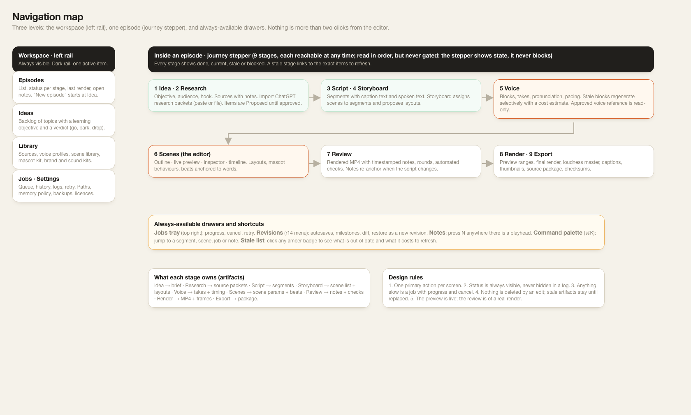
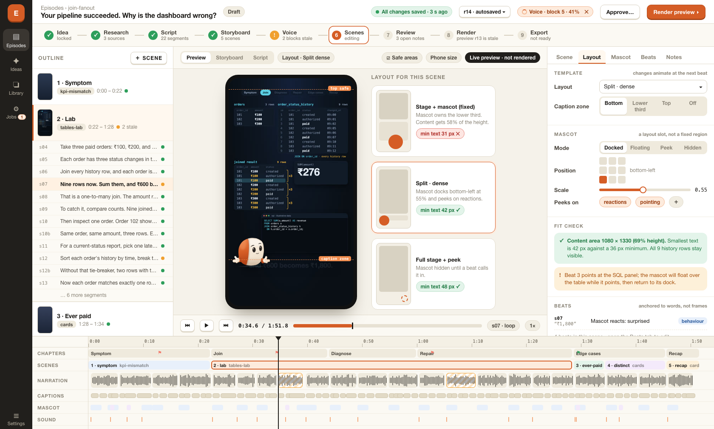
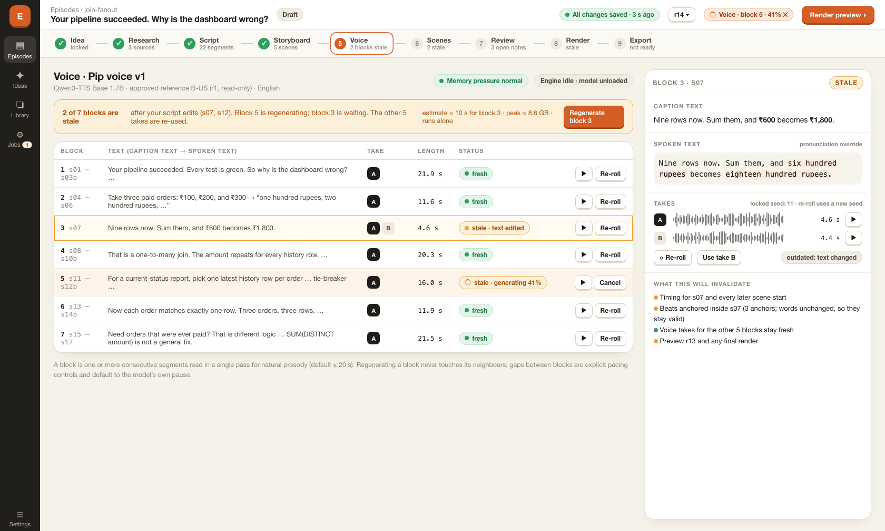
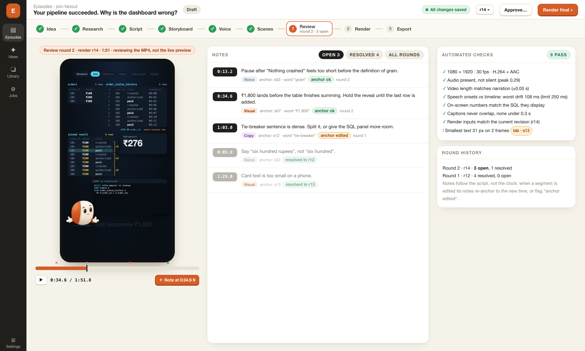

# 03 · Navigation and editor mockup

Interactive source: [mockups/episode-editor.html](mockups/episode-editor.html) (open in a browser; tabs switch screens). Static renders below.

**Honesty notes.** The timeline, segment text, durations and block lengths come from the real join-fanout timeline. The phone frame is a real still rendered from the current code at 36.7 s. The mascot in it was composited by hand to show the docked layout; the current episode scenes do not have one. Status values (stale blocks, open notes, "r14") are invented sample states. This is a mockup, not a running app.

## Navigation

* **Left rail (workspace):** Episodes, Ideas, Library (sources, voice profiles, scene library, mascot kit), Jobs, Settings.
* **Journey stepper (per episode):** nine stages, always reachable, showing done / current / stale / blocked. A stale stage links to the exact items to refresh.
* **Always-available:** jobs tray (progress, cancel, retry), revisions menu (autosaves, milestones, diff, restore), `N` to add a note, `Cmd+K` command palette, stale list behind any amber badge.

Design rules: one primary action per screen; status never hidden in a log; anything slow is a job with progress and cancel; edits never delete, stale artifacts stay until replaced; preview is live, review is of a real render.

## Episode editor (stage 6)

* **Outline (left):** scenes and their segments with status dots.
* **Preview (centre):** live preview with safe-area guides, caption zone, scene loop, and a "Layout for this scene" panel comparing three layouts with a fit check each. The fixed-mascot layout fails the minimum text size; split-dense passes. This is the direct answer to dense explanations being squeezed above a permanent mascot.
* **Inspector (right):** Scene, Layout, Mascot, Beats, Notes tabs. Layout tab shows template, caption zone, mascot mode/position/scale/peek triggers, fit check, and beats anchored to words.
* **Timeline (bottom):** chapters, scenes, narration waveform (stale blocks outlined), captions, mascot, sound. Playhead and note flags.

## Voice (stage 5)

Blocks with takes, length and status. Two blocks are stale after script edits; one is regenerating with a cancel button. The side panel shows caption versus spoken text, takes A/B, and exactly what regenerating would invalidate, with a cost estimate (time, peak memory, runs alone).

## Review (stage 7)

Review of render r14. Notes carry a timestamp, type, anchor and status, and some show "anchor edited". Automated checks sit beside the notes, with one warning for text below minimum size. Round history on the right.

## Known mockup limits

* The beats list is shortened; the Beats tab would hold the full list.
* The caption-zone guide label overlaps the sample caption in the preview.
* Only these four screens exist. Ideas, Research, Script, Storyboard, Render, Export and Jobs are described in the spec but not drawn.
