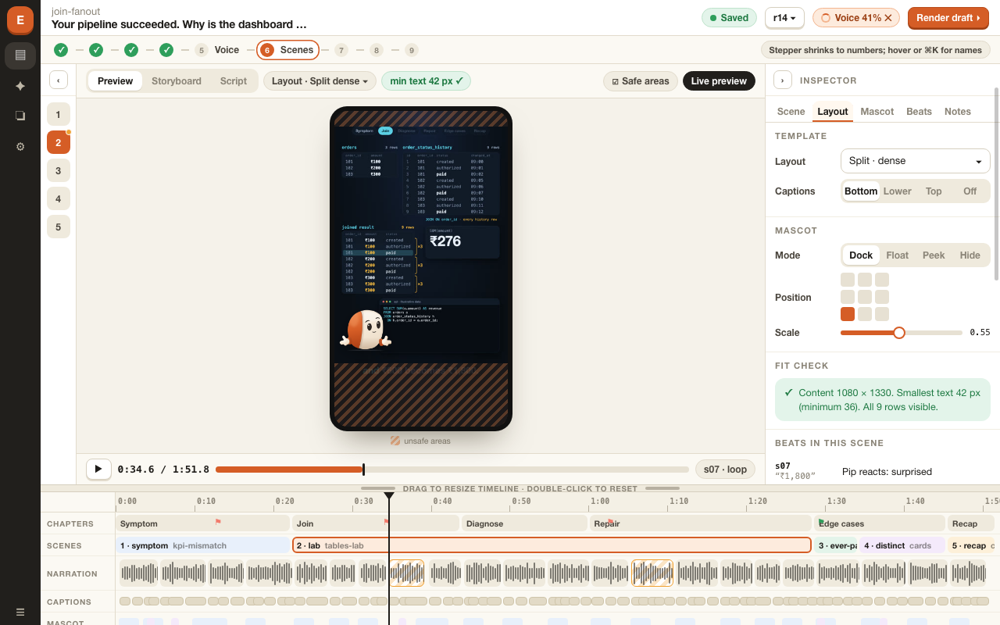
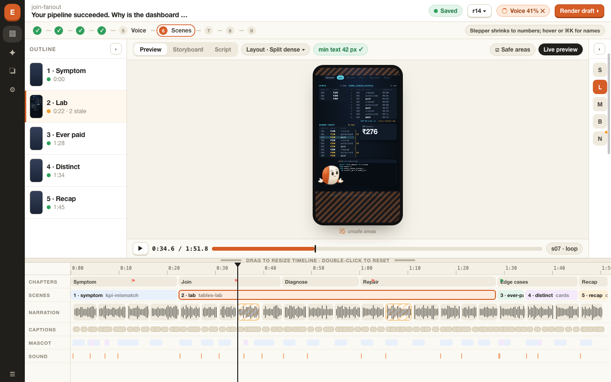

# 03 · Navigation and editor mockup

Interactive source: [mockups/episode-editor.html](mockups/episode-editor.html) (open in a browser; the top bar switches screens; at 1280 × 800 the collapse buttons and the timeline handle work).

**Honesty notes.** The timeline, segment text, durations and block lengths come from the real join-fanout timeline. The phone frame is a real still rendered from the current code at 36.7 s. The mascot was composited by hand to show a docked layout; the current episode scenes do not have one. Status values (stale blocks, open notes, "r14", check results, loudness) are invented sample states. This is a mockup, not a running app.

## Navigation

* **Left rail (workspace):** Episodes, Ideas, Library (sources, voice profiles, scene library, mascot kit), Jobs, Settings.
* **Journey stepper (per episode):** nine stages, always reachable, showing done, current, stale or blocked.
* **Always available:** jobs tray, revisions menu, `N` to add a note, `Cmd+K` command palette, the stale list behind any amber badge.

Rules: one primary action per screen; status never hidden in a log; anything slow is a job with progress and cancel; edits never delete; the preview is live, the review is of a real render. The review loop (draft, review, final mastered render, approval, export) is in [02](02-product-spec.md#2-the-review-loop).

## Episode editor (1680 × 1010)

Outline, live preview with layout alternatives and a fit check each, inspector, timeline. Unsafe areas are shown as shaded bands with a legend under the phone; nothing is drawn over the content or its caption. The header offers **Render draft**; there is no approve button here, because approval exists only after a final render.

## Editor at 1280 × 800

Editing state: outline collapsed to scene numbers, inspector open, timeline short with lanes scrolling.

Timing state: inspector collapsed to tab letters, outline open, timeline taller.

How it works: each side panel has a collapse button; the strip keeps navigation (scene numbers, tab letters, stale and note markers). The timeline's top edge is a drag handle (double-click resets); a short timeline scrolls its lanes. The stepper shrinks to numbers. The preview phone scales to the height that is left, so the trade is visible: a taller timeline means a smaller preview.

## Voice (stage 5)

Blocks with takes, length and status. Block 5 is stale and generating, block 3 is stale and queued, so the engine chip reads "Qwen3-TTS loaded · generating block 5". A queued draft render waits behind voice; the note under the table states that the engine unloads and release is confirmed before the render starts.

## Review (stage 7)

A draft render under review. Notes sit beside **measured** checks (narration complete, caption and spoken text, fonts, overflow, timing with its source labelled `estimated`, render inputs, text size, and "loudness not mastered in this file" for the draft), a **needs a person** list (listening, phone-size playback, custom scene frames, notes), and an **approval** card that explains what approval records and that export never renders or masters again.

## Known mockup limits

* Only these screens exist. Ideas, Research, Script, Storyboard, Render, Export and Jobs are described but not drawn.
* The 1280 × 800 mockups show two panel states; the interactive HTML lets you set others.
* The mascot overlay is illustrative.
