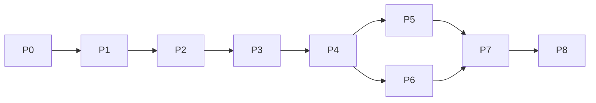

# 05 · Phased implementation plan

Sizes are relative (S, M, L), not time estimates. Each phase leaves a working system. "Acceptance" lists checks that can be run; where a check depends on listening or looking, it says so.

## Phase 0 · Foundations and safety nets (M)

Deliver:

* Test harness: `node --test` for TypeScript and `unittest` for Python, one command (`npm test`).
* Regression fixtures built from real data: the join-fanout episode with its **real Kokoro word timings** (from the narration cache), a golden timeline for them, golden normalised episode, invalid-episode cases, prototype manifest verification, and an opt-in slow check that re-renders a prototype frame and compares it with the preserved MP4.
* Repair of `episodes/_template` (invalid id) and the README (stale presenter and layout text, wrong Node version, missing test and Qwen setup).
* Explicit dependencies: the test scripts, the Node engine, `num2words` (used by `verify` but missing from requirements), a pinned Qwen environment file, and pinned Remotion renderer, bundler and player packages.
* Migration foundation: schema v2 draft, v1 to v2 migration, v2 to v1 downgrade, a command-line tool, and tests including a round trip.
* Git policy for generated media.

Acceptance (all run in Phase 0):

* `npm test` passes on the working tree.
* The golden timeline test fails if `pipeline/timeline.py` changes behaviour (checked by a deliberate temporary change).
* `./studio check` passes on every tracked episode including the template; `./studio new` produces a valid episode.
* v1 to v2 to v1 returns the original normalised episode for join-fanout, the template and my-topic.
* Prototype manifest hashes all verify; the opt-in render check passes at or above its stated threshold.
* Legacy commands (`check`, `narrate` cached, `verify`) behave as before.

Not in Phase 0: no new composition, no job runner, no storage, no UI, no model download.

### Phase 0 result

Done. Run `npm test` (84 tests: 54 TypeScript, 30 Python, all passing, under a second each) and `npm run test:slow`.

| Acceptance item | Result |
|---|---|
| Suite passes | 84 of 84; `tsc --noEmit` clean |
| Golden timeline detects changes | Measured: lowering `CUE_LEAD_SEC`, shrinking `MAX_CAPTION_WORDS`, restoring the invalid template id, and inverting the note-status mapping in the migration were each caught, then reverted |
| Fixtures reflect the real pipeline | The golden timelines built from cached Kokoro timings are identical to the timelines `./studio narrate` had already written, for both the full episode and the preview. Re-running the real CLI afterwards produced a timeline equal to the golden |
| Template and `new` | `./studio check` passes for join-fanout, the template and my-topic; `./studio new` makes a valid episode |
| Migration | v1 to v2 to v1 reproduces all three episodes exactly with nothing lost; v2 rules and downgrade warnings are tested |
| Prototype | Manifest hashes verify. Frame 170 re-rendered from the live code against the preserved MP4: **39.18 dB** PSNR (threshold 35) |
| Legacy commands | `check`, cached `narrate`, `new` and `verify --preview` behave as before |

Findings made along the way (not fixed, by design):

* `./studio verify episodes/join-fanout` on the full episode fails 2 checks today: caption "So when a" is shown for 0.275 s (limit 0.3 s), and the full MP4 does not exist. The first is pinned in a test so any change is visible.
* The preview MP4 passes `verify` even though it is older than the code, which confirms the stale-render gap in the audit.

Not tested: installing `requirements-qwen.txt` into a fresh environment (it equals the freeze preserved with the prototype and the installed environment), a clean-checkout run of `npm ci`, Linux, lint.

## Phase 1 · Project store and recovery (L)

Deliver: project database, blob store, commit protocol, revisions, projection writer with external-change detection, input snapshots and dependency hashes, invalidation graph, approval records, backup and restore, cache cleanup, recovery protocol.

Acceptance:

* **Kill test:** `kill -9` during a burst of edits, restart: every edit reported saved is present; no corrupt or half-written file; the database passes its integrity check.
* **One authority:** edits change the database and projection together; deleting `episode.json` and restarting recreates it; editing it by hand is detected and offered as an import, never overwritten.
* **Invalidation matrix:** each row of the tables in [02](02-product-spec.md#41-dependency-hashes) produces exactly the expected stale set, including fonts, assets, scene code, theme, narration, timing, sound mix and render settings each as the single changed input.
* **Snapshots:** a job started on r14 whose inputs change to r15 finishes as outdated; its output is kept and labelled r14; the current artifact and the approved pointer are unchanged (tested with a fake job).
* **Approval:** changing any hashed input voids approval and lists what changed; changing a review note does not.
* **Backup and restore:** backup a project that has revisions, selected takes, an approved reference, assets and an approved render; restore into an empty folder; every file verifies against the manifest; revisions, selections, approvals and artifact metadata are identical; the approved file's SHA-256 is unchanged. A damaged backup file is rejected.
* **Cleanup:** after thinning old revisions, cleanup never removes a blob reachable from a retained revision, an approval, a current artifact or an in-flight job (tested against a generated reference graph); dry run lists exactly what a real run removes.

### Phase 1 result

Implemented in `core/` (SQLite via `node:sqlite`; no UI, no workers, no model use). Run `npm test` (289 tests: 259 TypeScript, 30 Python; about 30 s because of the randomised and kill tests) and `npm run typecheck`. Every destructive test uses a temporary project; the test helpers refuse any path outside the system temp folder or inside the repository.

| Acceptance item | Result |
|---|---|
| Kill test | A separate process saves in a loop and reports each save after its commit returned; it is killed with SIGKILL after a varying number of saves, six rounds in a row on the same project. Every reported edit was present after each restart, `integrity_check` was ok, every blob row had its file, the projection was a whole valid file and was never mistaken for a hand edit |
| One authority | Edits change the database and then the projection; a deleted file is recreated; a hand edit is detected (live and on reopen), later saves leave it alone, import makes a new `import` revision that keeps beat ids, block plans and layouts, and "keep project version" saves the discarded bytes to `.studio/backups` |
| Invalidation matrix | 25 single-input changes, each producing exactly the expected stale set: spoken text, spoken override, caption only, scene params, layout, beat, chapter, pacing, block gap, voice settings, voice runtime, aligner, manual timing, timeline logic, sound events, sound assets, mix params, mastering targets, theme, a font, an asset, scene code, versions, render settings, and "title, notes, sources, status" (nothing stale). Also take switching, timing regeneration, block merge and a missing output file |
| Snapshots | A job started before an edit finishes as `outdated`: output kept and labelled with its revision, current pointer and approved pointer unchanged. The frozen episode copy is unaffected by later edits. A completed job never moves the approved pointer |
| Approval | Refused unless the final render is fresh, mastered, verified by hash, all required inputs are recorded and four sign-offs are given; all problems are listed together. Voided by 10 different single changes, each listing the parts that changed; not voided by title, notes or sources. A damaged approved file is caught when fetched |
| Backup and restore | Self-contained checksummed folder with the approved reference (the real Pip reference, copied), selected takes, approved render, and source files. Restore into an empty folder reproduces revisions, refs, selections, approvals, components and artifact metadata exactly and the approved file's SHA-256. A flipped byte, a missing file, a tampered manifest, a non-empty target and a missing retained blob are all refused, and no half-made folder is left |
| Cleanup | Dry run equals the real run. Unreachable blobs inside the grace period stay. Six randomised 90-step histories (edits, jobs, selections, pins, references, approvals, component changes, thinning, cleanup, running jobs) lose nothing reachable, checked by a separate row-by-row walk; dry run equals real run; a second cleanup finds nothing; the cleaned project still backs up and restores |
| Compatibility | Production never substitutes a Kokoro voice for a Qwen episode (library, `validate.ts` and `./studio check`, with or without acknowledgement); lossy exports need `--accept-loss` |
| Mutation checks | 18 deliberate breakages of reachability, hashing, job completion, approval, projection, backup and compatibility rules were each caught; one (approved-render root) initially was not, and a test was added |

#### Review fixes (independent review of Phase 1)

An independent review found four problems; each is fixed and has regression tests in `tests/store/review-fixes.test.ts` (84 tests, run in temporary folders only). The reviewer's three reproductions were re-run and now report: path escape refused and nothing written outside the target; recovery skips the corrupt newest backup and restores the valid older one; the cleanup preview deletes 21 blobs and thins 20 revisions, the real run deletes the same 21 and thins the same 20, with 0 unpreviewed deletions.

| Finding | Fix | Regression coverage |
|---|---|---|
| Restore accepted `files/../x` | The whole manifest is validated before anything is read or written: shape, kinds, normalised relative paths (no absolute, backslash, `.`, `..`, empty or trailing segments), allowed destinations (not `.studio` or `.git`), blob names equal to their hash, exactly one database entry, duplicate paths, case-insensitive destination collisions, file-versus-folder conflicts. Sources must be regular files reached without any symlink. Each destination is confirmed to stay inside the staging folder. The staged database is checked (integrity, schema version, foreign keys, blobs listed equal blobs shipped) and the normal recovery protocol is run on it before one rename publishes it | 24 manifest cases, the reported sentinel repro, symlinked file, folder and manifest, a non-database, a newer-schema database, a database referencing an absent blob, an unknown extra blob; each also checks that nothing is published, no staging folder is left and nothing appears outside the target |
| Cleanup preview omitted thinning | `planCleanup` computes, without changing anything, which revisions would be thinned and which blobs that frees. `executeCleanup` runs exactly that plan inside one transaction, after recomputing a fingerprint of every table and file listing the plan depends on; a mismatch raises `StalePlanError` and removes nothing. The CLI previews with a digest and `--apply` requires `--expect <digest>` | The reported repro, "planning never mutates", seven kinds of change after the preview (edit with revision, new blob, pin, new revision, started job, new reference, temp file), a job ending after the preview, an unchanged project executing after time passes, digest behaviour, CLI refusals |
| Recovery stopped at a corrupt newest backup | Candidates are validated read-only (integrity, schema version) and skipped if unusable, newest first by timestamp. The chosen backup is copied and the copy validated; only then is the current database moved aside and the copy renamed into place, with the originals put back on failure. Handles are closed in `finally` | The reported repro, several kinds of bad candidate, numeric ordering, no usable candidate leaves the database byte-identical with no leftovers, a failure while publishing, read-only probing leaves backups untouched, 40 failed candidates leave no open handles |
| Lock failed open when `ps` was unavailable | `core/lock.ts`. "Dead" only when the OS reports ESRCH, or the pid now has a different start time. A blocked, failing, timed-out or empty process inspection, EPERM, an unrecorded start time and an unreadable lock file are all "unknown", and unknown refuses the second writer with an explanation and leaves the lock in place. The lock is created whole and atomically. Backup recovery uses the same rule | Probe tests with injected failures (ESRCH, EPERM, EACCES, ENOENT, timeout, empty output, other errors), verdict table, the reported two-opens case with inspection unavailable, malformed lock files, pid reuse, dead holder; the whole store suite also passes with a deliberately blocked `ps` on PATH |

Mutation checks for these fixes: 18 deliberate breakages (path rules, symlink check, staged validation, duplicate and kind checks, thinning in the plan, staleness check, fingerprint inputs, recovery skipping and ordering, and four lock rules) were each caught. One fingerprint input (running jobs) is covered by two redundant tables, so removing one alone is not detectable by design; removing both is caught.

Limits, stated plainly:

* SIGKILL tests process death, not power loss. The design uses `synchronous=FULL` and flushes files and directories, but a real power cut was not tested.
* Backups are taken at open when the last is older than 6 hours, before migrations and before approvals; there is no background timer yet (no long-running process exists until Phase 4).
* Cleanup of worker processes after a crash was Phase 2 and is done: recovery now stops what the failed job's recorded processes left behind, after identity checks ([Phase 2 result](06-phase2-acceptance.md)).
* Timing, mix and render hashes are exercised with fake output files. Real component capture (code closure, fonts) arrives with Phases 2 and 3.
* Concurrent use by two processes is prevented by the lock, not tested under load.
* A cleanup plan becomes stale on any relevant change (even a new blob), so a busy app will need to refresh the preview often; that is deliberate.
* A lock whose holder cannot be inspected is never taken over automatically; the message says how to remove it by hand once you have confirmed nothing else is running.

Plan changes from this phase:

1. **Mix inputs** are the selected takes, pacing, gaps and mix settings, not the timing artifact, so caption edits do not force a remix ([02 §4.1](02-product-spec.md#41-dependency-hashes) updated).
2. **Take switching** stales the mixes as well as timing and renders (the Phase 6 criterion below is corrected).
3. **Projection format:** `episode.json` stays v1 while the document converts losslessly, and becomes v2 otherwise, so the legacy commands refuse it instead of dropping information. Custom block boundaries count as v2-only.
4. **Approval requires** the four manual sign-offs to be recorded (previously Phase 7), because the spec says approval cannot exist without them. Playback-range coverage remains Phase 7.
5. **Mastering targets** are a project component with default −16 LUFS and −1.5 dBTP, changed through the same mechanism as any hashed input.

## Phase 2 · Job runner, audio worker, render worker (L)

**Status: implemented and closed out. Reliability gaps found after the first report (settings read at run time, silently ignored inputs, no real final path) are fixed; the real final mix and render were measured. Results, limits and what still needs your listening and viewing: [06 Phase 2 acceptance](06-phase2-acceptance.md).** The criteria below are the original ones; the result document maps each to its evidence.

Deliver: runner with two lanes, audio worker with block cache, timeline wrapper around the Python code, render job with progress and cancel, memory guard, alignment spike.

Acceptance:

* **Selective regeneration:** edit one sentence in a multi-block episode; exactly one block regenerates; the rest are cache hits (counted from job records).
* **Timeline wrapper:** output equals the Phase 0 golden timeline for the fixtures.
* **Unload transition (tested, not inferred from timestamps):**
  1. With a test worker that holds a known amount of memory: after `unload`, the scheduler records the worker's reply and a measured drop in its resident memory before the render job enters Running.
  2. With a test worker that ignores `unload`: the scheduler terminates it, confirms the exit, and only then starts the render.
  3. With a worker that cannot be stopped: the render fails in Preparing with a reason and the heavy slot is free afterwards.
  4. With the real Qwen worker: one measured run records resident memory before unload, after unload, and at render start, and the render only starts below the threshold.
* **Cancellation:** cancelling a render or an audio job stops every descendant process (including a test child that spawns grandchildren and one that changes its process group), leaves no partial file in the project, and frees the heavy slot; a new heavy job can start immediately.
* **Restart recovery:** killing the app mid-job and restarting shows the job as Failed (interrupted) with a working Retry, no orphan processes, and a free slot.
* **Lane rule:** a queued audio job and a queued render never run at the same time.
* **Alignment spike:** after the author approves the download, report model size on disk, peak memory, and error against hand-marked word boundaries on a sample, with the decision made explicit. Timing source labels (`aligned`, `estimated`, `manual`) flow into the timeline and are visible in the output.

## Phase 3 · Scene library, layouts, fonts (L)

Deliver: scene registry and `SceneDefinition`; generic Episode composition; layout templates; mascot slot; existing scenes ported; fonts loaded from tracked files; `pip-scene-10x` recreated as a Tier 3 scene.

Acceptance (revised after the Phase 3 approval; the table-lab visual criterion is replaced, see `07-phase3-acceptance.md` for the results):

* **Prototype parity, in two stages.** (a) The frozen prototype scene, registered unchanged as a custom scene and rendered with its original timing, audio and authored performance, matches a live render of the prototype and, against the preserved MP4, sits inside the PSNR distribution that the prototype's own live-code-versus-MP4 comparison produces over representative frames (no threshold derived from a single frame). (b) The same scene produced by the pipeline (aligned timing, mastered mix with accents) with the differences caused by alignment identified and measured. Speech-to-visual sync is within one frame of the timeline; a visual review of both is recorded as the author's, not as a check.
* **Performance as data:** for every frame of the prototype the data-driven pose equals the original `perform` output within a stated numeric tolerance.
* join-fanout (legacy dark style) renders through the generic composition with an unchanged timeline: a regression check only.
* **A dense Pip-style layout fixture** renders with every card visible and text at or above the minimum size; the fit check passes for the dense layout and flags the same content in the fixed-mascot layout.
* Fonts load from tracked files with their licences; removing or altering a font file makes the font check fail. The prototype's own system-font render stays as the comparison reference.
* Sound accents are mixed through the real mix path, recorded in job snapshots and dependency hashes, and measured in the final mix; unsupported sound features still fail explicitly.

### Creative baseline and how Phase 3 carries it (approved with refinements; delivered, see the acceptance document)

**Decision recorded:** the creative baseline is `prototypes/pip-scene-10x-v1/` (Pip's character, expressive performance and warm-paper direction). The table-lab output of Phase 2 is a technical pipeline test only: its visual style was rejected, it is not a baseline, and no further table-lab samples are made. Mascot and voice design are not reopened.

**Update after Phase 8 (the author's visual feedback):** the prototype stays the reference for Pip's character and expressive performance. For **explanatory visual storytelling** the primary benchmark is now `out/phase4/slice2/context-window_slice2_rebuilt.mp4` (SHA-256 `cd6fa2aaf645b7df120c40edc9c5feebdb1c9c4e107acff53038202dd2d7fd08`), which the author found "much clearer and more visual than the Phase 8 final output". Concepts are shown through changing objects, states and relationships; an object stays on screen while the idea continues; cards are used selectively, and narrated text cards with mascot gestures are not the default. The Phase 8 final output demonstrates the production workflow and is not a creative benchmark. The benchmark is a quality reference, not a template. Comparison, hypotheses and review records: `15-creative-benchmark-and-review-records.md`.

**What the prototype is, in code** (live code behind the frozen MP4, in `src/art/`): `pip-layers/` (the layered figure, hands, views), `pip-scene/rig.ts` (`perform(t, timing, anchor, target)` returns Pip's pose from keyframe tracks keyed to named cues: gaze, brows, lids, smile, smirk, tilt, hands, point), `pip-scene/PipScene10x.tsx` (the scene: card, claim, callout, lanes, caption pill, floor shadow), `palette.ts` and `parts.tsx` (warm paper, slab, tag, backdrop). It is driven by `timing.json`: segment and phrase times, named cue times, a per-frame mouth-opening track from the voice loudness, and a sound-accent list. Everything the author approved lives in those tracks and that geometry.

**How the scene library carries it, in three steps, each gated by a test:**

1. **Adopt unchanged.** Register `pip-scene-10x` as a Tier 3 `SceneDefinition` whose component is the existing `PipScene10x`, not a rewrite. The generic composition supplies its `Timing` from the pipeline: segments and phrases from the aligned timeline, cue times from the episode's beats, the mouth track from the voice audio, accents from the sound-event list. Gate: re-render from data with the prototype's own timing and audio, and compare with the preserved MP4 at one sampled frame per cue plus the start and end, with the PSNR threshold fixed before the run (the prototype's own live-code-versus-MP4 comparison measured 39.2 dB at frame 170, so the threshold will sit just below what that comparison achieves) and speech-to-visual sync within one frame. A second render with aligned timing shows the visual difference caused by timing alone.
2. **Make the performance data without changing it.** Copy `perform` into the library with its keyframe tracks expressed as a score (track, cue name plus offset, value, easing). Gate: for every frame of the prototype, the data-driven pose equals the original `perform` output exactly (a numeric test, stronger than PSNR). The score stays authoritative: named expressions (`neutral`, `thinking`, `surprised`, `happy`, `concerned`, `pointing`) are optional presets layered on top, never a replacement for the authored continuous tracks, so the expressiveness is not flattened.
3. **Build new Pip scenes from the same parts.** The library exposes what the prototype already has as reusable pieces: Pip performer (figure, score, mouth, shadow), mascot slot (the prototype geometry is the first template, `card-over-pip`: card above, Pip anchored lower left at about 0.68 scale, caption zone at the bottom), Pip caption pill with emphasis, slab/tag/backdrop parts, scene-supplied anchors Pip can look or point at, and `SceneDefinition` (params schema, cue vocabulary, anchors, layout needs, optional checks). The next representative sample is a new Pip scene built this way, with narration in the approved voice. It is not a table-lab scene.

**Decisions as taken (from the original proposal):**

* **Editing `src/art`.** The repository rules protect it. The plan above does not edit it: new code goes in a new folder and imports the art modules unchanged. Say if you want otherwise.
* **Sound accents.** The prototype mixes seven synthesized accents (pop, ding, chime, thump, tick, whoosh, swish; `scripts/pip_scene_timing.py`). Phase 2 rejects sound events. Parity of the performance includes them, so the recommendation is a narrow accent mixer limited to those synthesizers, with no new assets. Otherwise audio parity excludes accents and says so.
* **Caption style and emphasis.** The prototype's caption is a dark pill with orange emphasis on marked words; the generic caption is different. Carrying it needs a way to mark emphasis in caption phrases (a schema addition that the "captions spell the segment text" check must strip).
* **Fonts.** The prototype uses the system stack starting with SF Pro, which cannot be redistributed. Parity on this machine uses it as is. Bundling a licensed font changes the approved typography, so it should be compared side by side before you choose.
* **Theme.** Two looks exist: warm paper (Pip) and the dark theme the generic scenes use. Proposal: warm paper becomes the production theme; the dark theme stays only for legacy episodes and technical tests.
* **Sample content.** Candidates for the new sample, none yet written: a short Pip scene on the "compare counts" idea in `join-fanout` (segments s09 to s11), or another script you supply. Narration would be generated in the approved voice and needs your listening.
* **Acceptance changes (done).** Replaced "a dense scene (table lab) renders in split-dense" with a dense Pip-style layout fixture, and keep "join-fanout renders through the generic composition with an unchanged timeline" as a regression test only.

## Phase 4 · App shell and editor (L)

Deliver: navigation, outline, Player preview, inspector forms, timeline lanes, autosave indicator, revisions menu, jobs tray, stale badges, layout for small screens.

Acceptance:

* Autosave states are truthful: stopping the server shows an error state, not "saved".
* A text edit turns the expected badges amber within one second; clicking shows what is stale and the cost.
* **At a 1280 × 800 viewport:** the editor has no page-level scrollbars; with the outline and inspector collapsed the preview gets the freed width; dragging the timeline edge changes its height between a minimum and maximum, double-click resets it, and the sizes survive a reload (measured in a headless browser).
* Preview and a rendered frame agree visually at three sampled times (by eye, recorded).
* Keyboard path exists for add note, play and pause, next segment.

## Phase 5 · Research, script, storyboard, ChatGPT import (M)

Acceptance:

* Invalid JSON shows the exact path and reason and imports nothing.
* A plain script splits into segments the author can adjust before accepting.
* Imported items stay Proposed until approved; provenance (source, date, hash) is stored.
* No network request is made during import (checked with networking blocked).

## Phase 5B · Scenes: from an accepted storyboard to scenes in the episode (S-M, scheduled before Phase 6)

Why it is scheduled here: the original journey is Idea, Research, Script, Storyboard, Voice, **Scenes**, Review, Render, Export. Phase 5 stopped at the storyboard and Phase 6 starts with voice, so nothing yet carried an accepted storyboard into the episode's own scenes. This phase closes that link and stops there; it adds no voice, review, render or export work.

Deliver: a previewed, conflict-checked "apply storyboard" (`episodeScenesFromPlan` through the normal validated save and revision path); a Scenes step with validated controls for registered scene types and raw JSON as an advanced option; one bounded reusable Pip scene (`pip-cards`, built from the approved Pip parts) so a genuinely reusable Pip scene exists; a composition preview clearly labelled as an estimate; the production preflight reading the episode's own scenes.

Acceptance:

* Applying shows a preview of what would change; only a complete, valid plan applies; missing narration, invalid parameters, unsupported or custom types and missing cue words are each reported by scene.
* The apply is one revision on the normal save path with the sequence check; a stale plan or episode refuses it and changes nothing; existing scene work is replaced only after an explicit yes, and the earlier version is a revision of its own.
* Pip-action and "what is shown" prose stays a labelled planning note; Pip does only the supported actions the author sets as parameters; cues must name words that are spoken.
* The rejected table-lab look is not the default for new Pip episodes (the dark legacy scene types are unsupported in a Pip-style episode).
* Applying invalidates only the outputs that depend on what changed (a card's text or layout: the video; a cue that moves: timing, and with sound events the mix, and the video); narration is kept where its inputs are unchanged.
* With no narration or timing the preview is an estimate on a made-up clock, says so, has no audio and is never offered as a build.
* A separate draft goes from accepted script to valid storyboard to applied scenes to a clean production preflight, with no narration or render made; the approved baseline is unchanged and recoverable.

Out of scope and deferred: optimizing the render-source hash (it stays conservative, so any `src/**` or `package.json` change marks the baseline's final video as needing a rebuild); per-episode sound events (done at the start of Phase 6); new scene types beyond `pip-cards`; any 3D work.

## Phase 6 · Voice stage (M)

Acceptance:

* Re-roll adds a take and never overwrites one; switching takes marks timing, mixes and renders stale and nothing else (mechanism and tests exist from Phase 1).
* Split and merge of blocks keep segment order and invalidate only the affected blocks.
* The displayed estimate is within 30% of the measured time on a test block.
* The voice screen's engine state always matches the job state (a job cannot show "generating" while the engine shows "unloaded"); tested against the job table.
* Listening check on a real multi-block episode for seams, recorded as a judgement.

### Phase 6 result

Implemented; the automated checks and one bounded real narration run are reported in [12 Phase 6: Voice](12-phase6-voice.md). **Your review is pending**; no listening judgement or approval is recorded. Added to this phase as its first step, because Phase 5B left it open: sound settings (sound events and mix settings) now belong to each episode, so a new episode starts without the context-window accents and changing one episode's sound cannot change another's. Not done, and not part of this phase: Phase 7 work, publishing, packaging, any 3D work, any change to Pip's character or voice reference.

## Phase 7 · Review, final render, approval, export (L)

Deliver: notes and rounds, draft and final renders, mastering, check suites, manual sign-offs, approval, export.

Acceptance (each check has a fixture that must fail and one that must pass):

* **Narration:** a segment with no take, a take whose file is missing, a truncated take (ends abruptly), and a take with a long silent gap are each reported. A dropped word is **not** reported automatically; the manual listening item covers it, and the UI says so.
* **Captions vs spoken text:** a missing override for a symbol, a number spoken differently from its caption, and an unlisted word difference are each reported; an intentional difference confirmed by the author passes.
* **Fonts and layout:** a scene with an unloaded font reports fallback; text that overflows its box, essential boxes that overlap, and an essential element under the mascot or inside the unsafe area are each reported; a scene without marked elements is reported as only partly checked.
* **Mastering:** the loudness measured on a final MP4 matches the target within tolerance; the same measurement on a draft reports "not mastered"; a final file that was altered after rendering fails the hash check.
* **Approval and export:** approving records the file hash and input hash; changing any hashed input voids approval; export copies the approved file so its SHA-256 is unchanged, spawns no render or encode process (verified by process monitoring), and stops with an error if the file is missing or altered.
* **Manual review:** approval cannot be recorded until the four manual items are ticked and the final file's playback ranges cover the whole file; the UI states these are recorded actions, not verification.
* **Custom scenes:** a Tier 3 scene without its own checks is reported as generic-checks-only.

### Phase 7 result

Implemented; the automated checks (698 fast tests, 54 slow tests, see [13 Phase 7](13-phase7-review.md)) and one real draft-to-final
demonstration are reported there. **Your review and approval are pending**: the demonstration's final video was checked by the app
(22 pass, 2 warnings, 0 fail, 2 not examined; loudness measured at -16.1 LUFS) and left unreviewed, with no sign-off ticked, no playback
recorded, no approval and no export. Approval and export were exercised only in isolated test projects with simulated sign-offs. One real
defect was found and fixed on the way (a spoken-text edit kept the old caption line breaks). Not done, and not part of this phase: Phase 8,
packaging, publishing, 3D work, external tools.

## Phase 8 · Hardening (M)

Acceptance: full regression suite passes from a clean checkout; backup then restore on a fresh machine path reproduces a project; performance targets set from the first real measurements; empty states and shortcuts; Remotion licence position recorded.

### Phase 8 result

Implemented and technically verified as recorded in [14 Phase 8](14-phase8-hardening.md); **nothing in it is human-approved**. A separate persistent
project route replaced the demo-only restriction (`./studio-app new` and `open`; the checkout is refused); a whole journey was run on a new project
with the real tools and again from a clean source snapshot with freshly installed dependencies; backup and restore were verified on both real
projects and in isolated projects; bundled fonts are the default for new episodes; the production checks, recovery and the app were hardened where the
journey and the audit found real faults (listed in the document, including two checks that failed a correct video and a backup that dropped saved
narration takes). The Remotion licence position is recorded from the official text without deciding it. Acceptance items: "full regression suite
passes from a clean checkout" (see the document's final regression), "backup then restore on a fresh machine path reproduces a project"
(verified), "performance targets set from the first real measurements" (measured and stated as expectations, not promises), "empty states and
shortcuts" (done and tested), "Remotion licence position recorded" (recorded). Not done, by instruction: packaging, publishing, 3D, external
tools, adoption of the real checkout.

## Future milestone: more than one production tool (not started, planning only)

Direction recorded in Phase 6 and nothing built for it: one Pip studio, one channel identity, with more than one production tool available per episode or per scene. "Multiple tools" means the choices of how a scene is produced; it does not mean running several heavy jobs at once. Narration, alignment, mastering, generation and rendering stay one at a time on the Mac.

Order, once the core workflow (Phases 7 and 8) is done and not before:

1. **Remotion stays the default** production tool for every episode and scene.
2. **Evaluate HyperFrames first.** Then evaluate selected Lemo-Opuscar workflows. Any other tool is a candidate only. Each tool is judged on licence, cost and compatibility (with the Mac, with the pinned dependencies, with the Pip assets) before anything is installed. No tool is installed, no renderer is migrated and no framework is designed ahead of that evaluation.

Requirements to carry into that evaluation:

* **Shared identity.** Every tool uses the same Pip assets, the same approved narration, the same palette and typography, the same captions and the same sound identity. A tool that cannot honour them does not qualify for a Pip episode.
* **Handoff brief.** Each scene given to a tool carries its objective, its narration, its duration and its visual beats, so the tool is given a brief and not the whole project.
* **Imported clips.** A clip a tool makes is imported with its provenance (tool, version, settings, who made it, when) and the hashes of the inputs it depends on. Freshness is tracked the same way as for built outputs: when the narration, duration or brief it was made from changes, the clip is out of date and says so.
* **One owner per layer.** Narration, captions and sound each have exactly one owner in a given scene, so nothing is duplicated (for example captions burned into a clip and drawn again by the studio, or narration inside a clip and laid under it again).
* **Common review and export.** The review checks and the export step are the same whichever tool made a scene. A scene a tool cannot be checked on is reported as only partly checked, as custom scenes are now.
* **Visible provenance.** The studio shows which tool produced each scene and which parts remain editable in the studio and which can only be changed by making the clip again.

## Dependencies

Phase 3 can begin in parallel with the second half of Phase 2 once the v2 schema is settled.
