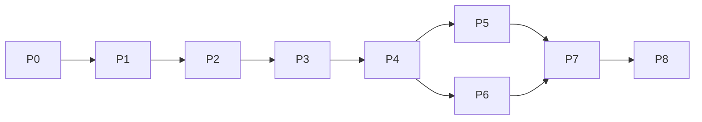

# 05 · Phased implementation plan

Sizes are relative (S, M, L), not time estimates. Each phase leaves a working system and has acceptance criteria that can be checked by running something.

## Phase 0 · Foundations and safety nets (M)

Deliver: `node --test` harness; golden fixtures from join-fanout (timeline, validation) and from the prototype; fix `episodes/_template` and README drift; binary-artifact and gitignore policy; declare dependencies explicitly; schema v2 draft plus v1 migration.

Accept:
* `npm test` runs and passes on a clean checkout.
* Migrating join-fanout v1 → v2 → validate passes, and rendering the result matches the v1 render's timeline exactly.
* `_template` passes `./studio check`.
* The preserved prototype manifest still verifies (SHA-256).

## Phase 1 · Core domain and storage (L)

Deliver: document store with journal, revisions, atomic writes, lockfile; artifact store keyed by input hash; SQLite job table; invalidation graph.

Accept:
* `kill -9` during a burst of edits, then restart: no edit that was reported saved is lost; no corrupt file.
* Invalidation matrix test: each row of the table in [02](02-product-spec.md#4-invalidation) yields exactly the expected stale set.
* Restore of r(N) creates r(N+1) and leaves history intact.

## Phase 2 · Job runner, Qwen worker, render worker (L)

Deliver: runner with lanes; Qwen TTS worker with block cache; timeline port; render job with progress and cancel.

Accept:
* Edit one sentence in a multi-block episode: exactly one block regenerates; the rest are cache hits.
* Timeline TS output equals `pipeline/timeline.py` on the golden episodes.
* Cancel stops a TTS or render job within 3 s and leaves no partial files in the project.
* App restart mid-job shows the job as Failed (interrupted) with a working Retry.
* A TTS job and a render queued together never overlap (logged timestamps).
* One real run logs duration, peak memory and pressure; the guard rule is exercised in a test with a simulated pressure feed.

## Phase 3 · Scene library and layout system (L)

Deliver: scene registry and `SceneDefinition`; generic `Episode` composition; layout templates; mascot slot; existing scenes ported; `pip-scene-10x` recreated as a Tier 3 scene.

Accept:
* Prototype parity: re-render from data matches the preserved MP4 at sampled frames (PSNR threshold stated up front) and speech-to-visual sync within ±1 frame.
* join-fanout renders through the generic composition with timeline unchanged.
* A dense scene (the table lab) renders in split-dense with all rows visible and text at or above the minimum size; the fit check flags the fixed-mascot layout as failing.

## Phase 4 · App shell and editor (L)

Deliver: navigation, outline, Player preview, inspector forms, timeline lanes, autosave indicator, revisions menu, jobs tray, stale badges.

Accept:
* Every edit shows saved/saving/error correctly; killing the server shows an error state, not a false "saved".
* A text edit turns the expected badges amber within one second; clicking shows what is stale and the cost.
* Preview and a rendered frame agree visually at three sampled times.
* Keyboard-only path exists for add note, play/pause, next segment.

## Phase 5 · Research, Script, Storyboard and ChatGPT import (M)

Deliver: stage screens; prompt templates; paste/file import for JSON, Markdown with JSON, and plain script; diff preview; provenance; per-section approval.

Accept:
* Invalid JSON shows the exact path and reason; nothing is imported.
* A plain script splits into segments the author can adjust before accepting.
* Imported items stay Proposed until approved; provenance (source, date, hash) is stored.
* No network call is made during import (verified by running with networking blocked).

## Phase 6 · Voice stage (M)

Deliver: voice profiles, block view, takes with A/B, re-roll, pronunciation overrides, pacing, cost estimate.

Accept:
* Re-roll adds a take and never overwrites one.
* Switching take marks timing and renders stale, and nothing else.
* Estimate shown before a run is within 30% of measured time on a test block.
* Listening check on a real multi-block episode for drift; result recorded as a judgement, not a measurement.

## Phase 7 · Review and export (M)

Deliver: notes with anchors and rounds, re-anchoring, automated checks, verify integration, export presets.

Accept:
* Edit a segment: its notes re-anchor or show "anchor edited"; none are silently lost.
* Notes export to Markdown and CSV with timestamps.
* Export produces final MP4, loudness-mastered audio, SRT and VTT, thumbnails, source package and a checksums file; checksums verify.
* Review refuses to open a render whose inputs differ from the current revision without a visible warning.

## Phase 8 · Hardening (M)

Deliver: performance pass, accessibility, shortcuts, empty states, backup/restore, migrations, optional launcher, regression suite, licence check.

Accept:
* Full regression suite passes from a clean checkout.
* A 10-minute episode outline and timeline stay responsive (target set when measured on the first real run).
* Backup then restore on a fresh folder reproduces the project.
* Remotion licence position recorded in `docs/`.

## Dependencies between phases

P3 can start in parallel with the second half of P2 once the schema is fixed.
